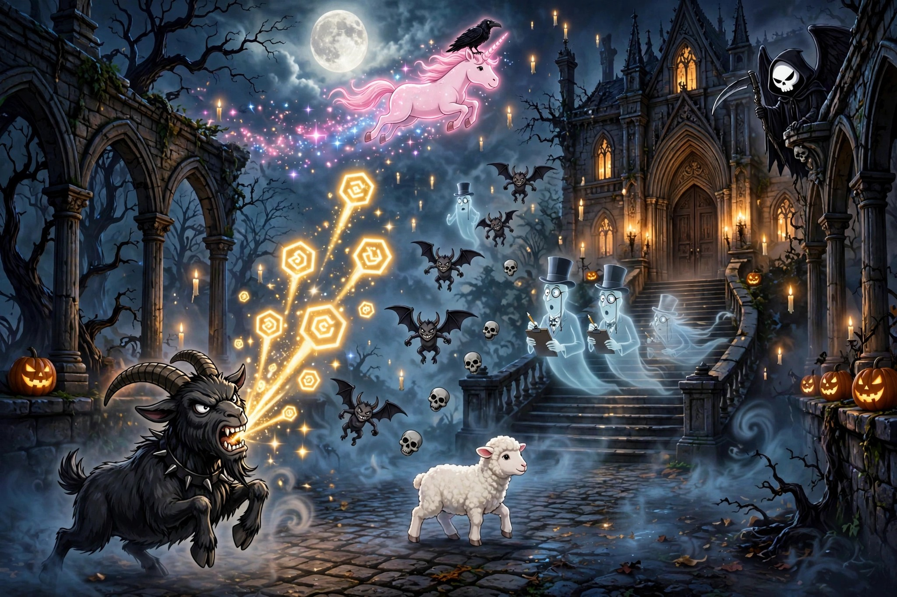
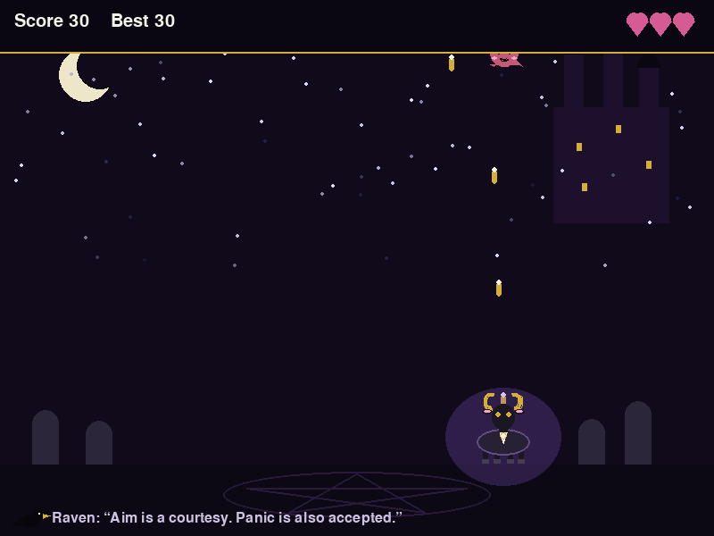

# Hooves of Hex

**Built with: Python + Pygame** 🐍 — a real Python game from the Grin Reaper arcade, playable in the browser via pygbag, or from source.



The haunting backlog has become unreasonable, so the black goat has taken matters into his own hooves. Blast the descending dead back into the filing system with golden hex bolts, catch the unicorn's golden rose for RAPID HOOVES, and whatever you do — do **not** shoot the white lamb. There will be a hearing. Death supervises with a clipboard. The Raven provides commentary nobody requested.

## ▶ Play in your browser

**https://itsgrinreaper.github.io/hooves-of-hex/**

Click the game, press ENTER, and begin the nonsense. (First load takes a moment — Python is moving into the browser and it travels with a lot of luggage.)

## 💻 Run from source

```bash
pip install -r requirements.txt
python main.py
```

## How to play

- **Move:** ◀ ▶ arrow keys or A / D
- **Fire:** SPACE — golden hex bolts, straight from the hooves
- **Start:** ENTER · **Retry after death:** R
- **Scoring:** Ghosts 10 · Demons 20 · Skulls 30 (skulls take two hits — the divas)
- **The white lamb is a protected species.** Let it cross for +25 Mercy. Shoot it and lose 50, plus your dignity.
- **Golden rose:** the pink unicorn drops one as she crosses — catch it for 8 seconds of RAPID HOOVES.
- **Lives:** 3 hearts. If three of the dead slip past the goat, the graveyard wins and your paperwork goes to Death.

## 📸 Preview



*The goat, mid-shift, expressing his feelings about the backlog in golden hexes.*

---

Part of the **Grin Reaper** arcade — new games daily at [github.com/itsgrinreaper](https://github.com/itsgrinreaper). Victorian, gothic, and only mildly haunted.
